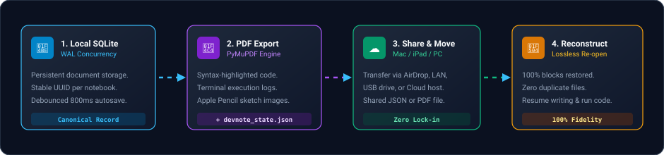
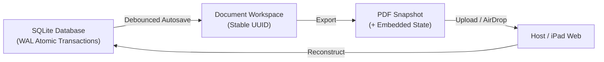

<p align="center">
  
</p>

<p align="center">
  <a href="https://python.org"></a>
  <a href="https://fastapi.tiangolo.com"></a>
  <a href="https://www.sqlite.org"></a>
  <a href="https://developer.mozilla.org/en-US/docs/Web/JavaScript"></a>
  <a href="#-running-automated-tests"></a>
  <a href="#license"></a>
</p>

<p align="center">
  <strong>DevNote</strong> is a high-performance, developer-focused technical notebook designed for <strong>macOS, Linux, Windows, iPad, touchscreen tablets, and desktop workstations</strong>. It unites the executable cells of <strong>Jupyter</strong>, the structured document flow of <strong>Notion</strong>, the distraction-free aesthetic of <strong>Linear / Obsidian</strong>, the expressive tactile precision of an <strong>Apple Pencil / Stylus sketchbook</strong>, a unified <strong>multi-source developer search engine</strong>, an offline-resilient <strong>research reader</strong>, and a private <strong>local AI assistant (Ollama / OpenAI / Gemini)</strong>.
</p>

---

## Interface Showcase

<p align="center">
  
</p>

---

## Highlights at a Glance

| Capability | Description | Architecture |
| :--- | :--- | :--- |
| **Executable Cells** | Run **Python 3** and **JavaScript** cells directly inline. | Isolated subprocess sandbox, memory caps, and timeout watchdog. |
| **Apple Pencil Dynamics** | Fluid handwriting, formulas, diagrams, and sketches. | HTML5 Canvas & Pointer Events API with native pressure curves. |
| **Unified Multi-Source Search** | Search General Web, Official Docs, Stack Overflow, GitHub, Wikipedia, Hacker News & Offline Docs concurrently. | Meta-Search (SearXNG default), direct API collectors, BM25 + intent reranking. |
| **Distraction-Free Research Reader** | Distill documentation and web pages into a clean reading format with in-page find and code extraction. | Resilient HTML parser, bundled SQLite FTS5 fallback packs, and 1-click notebook insertion. |
| **Local & Cloud AI Assistant** | Ask questions, explain active code cells, debug bugs, and summarize notes using local or cloud LLMs. | Pluggable provider adapter (Ollama local offline, LM Studio, OpenAI, Gemini). |
| **Hideable Workspace Sidebar** | Collapse the left navigation panel for full-width focus mode. | Keyboard shortcut <kbd>Cmd</kbd> + <kbd>B</kbd> / <kbd>Ctrl</kbd> + <kbd>B</kbd> with persistent state. |
| **Strict No-Duplicates** | Persistent canonical documents with stable UUIDs. | SQLite with WAL concurrency; editing never duplicates notebooks. |
| **Lossless Round-Trip** | PDF export embeds exact state for 100% fidelity continuation. | PyMuPDF engine + embedded JSON state payload. |
| **Local Network iPad Sync** | Host on Mac/PC, write seamlessly from iPad on local Wi-Fi. | Secure token-protected local network access (`--host 0.0.0.0`). |

---

## Feature Comparison Matrix

| Feature | DevNote | Jupyter Notebook | Notion | Obsidian |
| :--- | :---: | :---: | :---: | :---: |
| **Executable Inline Code** | Python & JS | Python/Kernels | Static text only | Plugins required |
| **Apple Pencil & Stylus Ink** | Native Pressure | Not supported | Not supported | Basic Excalidraw |
| **Unified Side-by-Side Search** | Built-in Multi-Source | No | No | No |
| **Distraction-Free Research Reader** | Built-in + Code Grab | No | No | Readwise plugin |
| **Local Offline LLM Assistant** | Ollama / LM Studio | Jupyter AI (heavy) | Cloud AI only | Community plugins |
| **Lossless Round-Trip PDF** | Embedded State | Static PDF | Static PDF | Static PDF |
| **Accidental Copy Prevention** | Canonical UUIDs | Duplicate `.ipynb` | Copy-paste drift | File name conflicts |
| **Zero Account / 100% Offline** | Yes | Yes | Requires cloud | Yes |
| **Terminal CLI Management** | `devnote` CLI | `jupyter notebook` | No | No |
| **Zero Framework Bloat** | Vanilla JS/HTML5 | Heavy React/Tornado | Heavy React/Electron | Electron |

---

## Two Distribution Editions

DevNote maintains shared application logic, document schemas, and frontend code across two distinct deployment targets:

### 1. Local Developer Edition (Primary)
> **Available for macOS (Apple Silicon & Intel), Linux, and Windows.**
- **Terminal First**: Install and launch directly via `pipx` or `pip`.
- **100% Private & Offline**: All notebooks, code, research bookmarks, and sketches reside on your local filesystem.
- **Zero Subscriptions & Zero Ads**: No accounts, no paywalls, no feature locks, and zero advertisements.
- **Local Subprocess Sandbox**: Isolated execution with environment sanitization and resource caps.

### 2. Hosted iPad Web Edition
> **Optimized for iPadOS Safari, touchscreen tablets, and cloud deployments.**
- **Mobile & Tablet Optimized**: Smooth touch scrolling (`touch-action: none` prevents stylus drawing conflicts).
- **Cloud Sandbox Ready**: Decoupled execution provider communicating with isolated cloud execution runners.
- **Ethical Monetization**: Funded solely via non-intrusive developer sponsorships in designated sidebar footer cards. **Advertisements are never placed inside notebook documents, code blocks, or drawings**, and private content is never shared.

---

## Cross-Platform CLI Guide

<p align="center">
  
</p>

### Installation

```bash
# macOS / Linux (Recommended via pipx)
pipx install devnote
devnote init
devnote start

# Windows (Command Prompt or PowerShell)
py -m pip install devnote
devnote init
devnote start
```

### CLI Command Reference

```bash
# Initialize storage and SQLite database
devnote init [--dir <custom_storage_path>]

# Start the application server (opens default browser automatically)
devnote start [--host 127.0.0.1] [--port 8000] [--daemon] [--no-browser]

# Stop background daemon server
devnote stop

# Open active workspace in default browser
devnote open [--port 8000]

# List all local notebooks in a formatted terminal table
devnote list [--archived]

# Export notebook to PDF or canonical JSON
devnote export <notebook_id> --format pdf --output ./notes.pdf
devnote export <notebook_id> --format json --output ./notes.devnote.json

# Import PDF or JSON notebook (Lossless round-trip with zero duplicates)
devnote import ./notes.devnote.json
devnote import ./exported_notes.pdf

# Run diagnostic health check across interpreters and system engines
devnote doctor

# Display version & system environment details
devnote version
```

---

## Local Network Access for iPad

Pair your Mac or PC notebook host with your iPad over your local Wi-Fi network:

```bash
devnote start --host 0.0.0.0 --port 8080
```

```
=================================================================
DevNote v1.1.0 (Local Edition — Cross-Platform)
=================================================================
   Local URL:    http://127.0.0.1:8080
   iPad / LAN:   http://192.168.1.50:8080?token=k9_sA7df8203...
   Access Token: k9_sA7df8203...
   Network Access Protected by Token Authentication
=================================================================
```

> [!IMPORTANT]
> **Network Security Guarantee**: Whenever DevNote listens beyond localhost (`0.0.0.0`), token authentication is automatically activated. Requests from your iPad without the access token are rejected with `401 Unauthorized`. Navigating to the generated link automatically authenticates iPad Safari.

---

## Canonical Document & Round-Trip Workflow

DevNote eliminates "accidental copy duplication" through a canonical document state machine:

<p align="center">
  
</p>



1. **Persistent Document Model**: Each notebook has a permanent UUID stored in SQLite. Editing or reopening restores the exact state.
2. **Debounced Autosave**: Changes save automatically after 800ms with a real-time status indicator (`Saving...` → `All changes saved`).
3. **Lossless PDF Embedding**: When exporting to PDF, DevNote embeds the canonical `devnote_state.json` payload directly into the PDF.
4. **Re-import Continuation**: Uploading the exported PDF reconstructs 100% of the blocks, execution outputs, and handwriting strokes without creating duplicate notebook records.

---

## Interactive Feature Guide

### 1. Rich Block Writing & Slash Menu (`/`)
DevNote is structured around independent, draggable blocks. Press `/` anywhere to summon the insertion palette:

- `/code` or `/python`: Insert executable Python 3 block.
- `/javascript` or `/js`: Insert executable JavaScript block.
- `/heading` (H1, H2, H3): Insert structured section headers.
- `/drawing`: Insert Apple Pencil & stylus canvas.
- `/checklist`: Insert interactive todo checkboxes.
- `/math`: Insert mathematical LaTeX formulas.
- `/table`: Insert data table grid.

### 2. Isolated Code Execution
Write standard Python or JavaScript code and click **Run** or press <kbd>Cmd</kbd> + <kbd>Enter</kbd>:

```python
# Executable Python block inside your notes
import math

def calculate_trajectory(v0, angle_deg):
    theta = math.radians(angle_deg)
    time_of_flight = (2 * v0 * math.sin(theta)) / 9.81
    max_height = (v0**2 * (math.sin(theta)**2)) / (2 * 9.81)
    return time_of_flight, max_height

tof, hmax = calculate_trajectory(25, 45)
print(f"Time of Flight: {tof:.2f}s | Max Height: {hmax:.2f}m")
```

- **Output Panel**: Captures standard output (`stdout`) and execution duration in milliseconds.
- **Error Panel**: Captures tracebacks (`stderr`) in a dedicated red error box.
- **Stop Button**: Halts long-running loops or timeouts immediately.

### 3. Unified Multi-Source Developer Search Engine
Click **Developer Search** in the sidebar or press <kbd>Cmd</kbd> + <kbd>K</kbd> to activate the side-by-side research workspace:

- **Unified Multi-Source Aggregation**:
  - Searches concurrently across **SearXNG / General Web**, **Official Docs (Python, FastAPI, Docker, MDN, DevDocs)**, **Stack Overflow**, **GitHub Repositories**, **Wikipedia**, **Hacker News**, and **Local SQLite FTS5 offline docs**.
  - All sources appear together in one aggregated, ranked list.
- **Default Search Provider: SearXNG Meta-Search**:
  - Privacy-first metasearch aggregation across DuckDuckGo, Brave, Startpage, Wikipedia, arXiv, and developer documentation.
  - **Zero Paid APIs Required**: Works out of the box with zero third-party API keys and zero page scraping.
  - **Docker Compose for Local Development**:
    ```bash
    docker compose up -d searxng
    ```
- **Deterministic Query Classification & BM25 Ranking**:
  - Automatically identifies query intent (*Error Troubleshooting*, *Documentation / Concept*, *Code Implementation*, *API Reference*).
  - Detects programming languages and frameworks, routing queries to high-scoring providers.

### 4. Distraction-Free Research Reader
Study technical documentation and web resources without leaving your notebook:
- **Article & Doc Distiller**: Extracts article titles, readable body HTML, and code blocks into a distraction-free native reader view.
- **Reader Toolbar Omnibox**: The top address bar accepts web URLs (to fetch and distill) or raw search queries (to run multi-source searches right inside the reader).
- **In-Page Find (<kbd>Cmd</kbd> + <kbd>F</kbd>)**: Search inside the distilled document with highlighted match navigation.
- **Reading Controls**: Quick font size scaling (<kbd>A-</kbd> / <kbd>A+</kbd>), reading width toggle (Standard, Wide, Full), and formatted citation generator.
- **Study & Evidence Capture**: 1-click **+ Insert Note**, **+ Insert Code**, and **+ Insert Evidence** append references directly into your active notebook.
- **Offline & Anti-Bot Fallbacks**: When external sites return 403 or anti-bot blocks, the reader seamlessly surfaces structured local docs and curated knowledge sets.

### 5. Local & Cloud AI Assistant (LLM Workspace)
An optional, distraction-free assistant integrated into your workspace:
- **Local & Offline First**: Connect to **Ollama** (`http://localhost:11434`, model `llama3`) or **LM Studio** (`http://localhost:1234/v1`). Zero cost, completely private, and runs 100% offline.
- **Cloud Providers**: Seamless support for **OpenAI** (`gpt-4o`, `gpt-4o-mini`) and **Google Gemini** (`gemini-1.5-flash`) via user-provided API keys.
- **Active Context Awareness**: Optionally attach your active notebook code cells and the current research document directly to prompts.
- **Action Chips**: Quick triggers for *Explain Code Cell*, *Summarize Notebook*, *Summarize Research*, *Debug / Fix Bug*, and *Python Solution*.
- **Notebook Ingestion**: One-click **+ Insert Note** and **+ Insert Code** push responses directly into your notebook blocks.

### 6. Apple Pencil & Stylus Handwriting
Integrated canvas block powered by HTML5 Canvas & Pointer Events API:
- **Pressure Dynamics**: Reads `e.pressure` to produce variable-width, natural ink strokes.
- **Tools**: Pressure Pen, Semi-Transparent Highlighter, Pixel Eraser, Undo/Redo, and Clear.
- **Color Palette**: Pitch Black, Royal Blue, Ruby Red, Emerald Green, Amber Orange, Purple.
- **iPad Palm Rejection**: Styled with `touch-action: none` so Apple Pencil gestures do not trigger unwanted page scrolling.

### 7. Hideable Sidebar & Focus Layout
- Collapse the left navigation panel via the sidebar header button or by pressing <kbd>Cmd</kbd> + <kbd>B</kbd> / <kbd>Ctrl</kbd> + <kbd>B</kbd> / <kbd>Cmd</kbd> + <kbd>\</kbd>.
- The collapsed state persists in `localStorage` across reloads.
- The 50%/50% split divider between the notebook and research workspace is fully draggable and touch-friendly.

---

## Keyboard Shortcuts Reference

| Shortcut | macOS | Windows / Linux | Action |
| :--- | :--- | :--- | :--- |
| **Toggle Sidebar** | <kbd>Cmd</kbd> + <kbd>B</kbd> or <kbd>Cmd</kbd> + <kbd>\</kbd> | <kbd>Ctrl</kbd> + <kbd>B</kbd> or <kbd>Ctrl</kbd> + <kbd>\</kbd> | Show or hide the left navigation sidebar. |
| **Search Workspace** | <kbd>Cmd</kbd> + <kbd>K</kbd> | <kbd>Ctrl</kbd> + <kbd>K</kbd> | Open or collapse Developer Search panel. |
| **Save Document** | <kbd>Cmd</kbd> + <kbd>S</kbd> | <kbd>Ctrl</kbd> + <kbd>S</kbd> | Save document immediately to SQLite. |
| **Execute Block** | <kbd>Cmd</kbd> + <kbd>Enter</kbd> | <kbd>Ctrl</kbd> + <kbd>Enter</kbd> | Run the active Python or JS code block. |
| **Component Menu** | <kbd>/</kbd> | <kbd>/</kbd> | Open block insertion slash command menu. |
| **Find in Reader** | <kbd>Cmd</kbd> + <kbd>F</kbd> | <kbd>Ctrl</kbd> + <kbd>F</kbd> | Open in-page find bar in research reader. |
| **Reader Back / Forward** | <kbd>Alt</kbd> + <kbd>←</kbd> / <kbd>→</kbd> | <kbd>Alt</kbd> + <kbd>←</kbd> / <kbd>→</kbd> | Navigate reading history back and forward. |
| **Smart Indent** | <kbd>Tab</kbd> | <kbd>Tab</kbd> | Insert spaces in code block without losing focus. |
| **Undo / Redo** | <kbd>Cmd</kbd> + <kbd>Z</kbd> / <kbd>Shift</kbd> | <kbd>Ctrl</kbd> + <kbd>Z</kbd> / <kbd>Shift</kbd> | Undo or redo text and canvas strokes. |

---

## System Architecture

```
devnote/
├── assets/                      # Animated SVGs, diagrams, and hero graphics
│   ├── devnote-banner.svg
│   ├── app-demo-mockup.svg
│   ├── roundtrip-workflow.svg
│   └── cli-terminal-preview.svg
├── devnote/                     # Core packaged distribution
│   ├── __init__.py
│   ├── cli.py                   # Cross-Platform CLI entry point (pipx / pip)
│   ├── paths.py                 # Cross-platform path resolution
│   ├── app/
│   │   ├── main.py              # FastAPI app, static mounts & auth middleware
│   │   ├── config.py            # Environment, edition & network settings
│   │   ├── database.py          # SQLite engine & WAL mode listener
│   │   ├── models/              # SQLite models (Notebook, Snippet, Execution, SearchHistory, SavedResource)
│   │   ├── schemas/             # Pydantic validation schemas
│   │   ├── routers/             # API endpoints (notebooks, execution, pdf, search, snippets, llm, news)
│   │   ├── research/            # Research Reader & Extraction Subsystem
│   │   │   ├── reader_service.py
│   │   │   ├── reader_router.py
│   │   │   ├── content_sanitizer.py
│   │   │   ├── source_detector.py
│   │   │   ├── url_validator.py
│   │   │   └── providers/       # Documentation, Article, GitHub, StackOverflow, Wikipedia
│   │   ├── search/              # Unified Multi-Source Search Subsystem
│   │   │   ├── search_service.py
│   │   │   ├── query_classifier.py
│   │   │   ├── ranking_engine.py
│   │   │   ├── cache.py
│   │   │   └── providers/       # SearXNG, DevDocs, StackOverflow, GitHub, Local FTS5, Wikipedia, HN
│   │   ├── services/            # Storage, Execution, Notebook, PDF, LLM Services
│   │   └── sandbox/             # Subprocess runner, resource limits & timeouts
│   └── frontend/                # Pure HTML5 / CSS3 / Vanilla JavaScript UI
│       ├── index.html
│       ├── css/                 # editor.css, main.css, reader.css, responsive.css, sidebar.css
│       └── js/                  # api.js, app.js, editor.js, code-blocks.js, handwriting.js, search.js, pdf.js
├── backend/                     # Compatibility forwarder & test suite
│   ├── app/                     # Compatibility proxies to devnote.app
│   └── tests/                   # Pytest automated test suite (60 tests, 100% passing)
├── storage/                     # SQLite database & exported PDF files
├── pyproject.toml               # Python package configuration
├── Dockerfile                   # Production container definition
└── docker-compose.yml           # Multi-platform orchestration (app + SearXNG)
```

---

## Docker & Container Deployment

Deploy DevNote along with a self-hosted SearXNG meta-search instance using Docker Compose:

```bash
# Build and run DevNote + SearXNG with persistent volumes
docker compose up -d

# Check running container logs
docker compose logs -f

# Stop containers gracefully
docker compose down
```

The container automatically mounts `./storage` to persist your notebooks, SQLite database, uploads, and PDF exports across container restarts.

---

## Running Automated Tests

DevNote includes a complete automated test suite covering notebooks, code execution, sandbox timeouts, PDF round-trips, multi-source search query classification, ranking, SQLite FTS5 offline docs, research reader SSRF validation, content sanitization, LLM providers, and end-to-end acceptance workflows:

```bash
# Run complete test suite (60 tests)
source venv/bin/activate
PYTHONPATH=. pytest backend/tests -v
```

```
============================= test session starts ==============================
backend/tests/test_cli_and_distribution.py::test_api_config_endpoint PASSED [  1%]
backend/tests/test_cli_and_distribution.py::test_json_export_and_import_endpoints PASSED [  3%]
backend/tests/test_cli_and_distribution.py::test_storage_provider_abstraction PASSED [  5%]
backend/tests/test_cli_and_distribution.py::test_execution_provider_abstraction PASSED [  6%]
backend/tests/test_cli_and_distribution.py::test_network_security_middleware PASSED [  8%]
backend/tests/test_cli_and_distribution.py::test_cli_execution_commands PASSED [ 10%]
backend/tests/test_devsearch.py::test_query_classifier_concept PASSED    [ 11%]
backend/tests/test_devsearch.py::test_query_classifier_error PASSED      [ 13%]
backend/tests/test_devsearch.py::test_query_classifier_code_implementation PASSED [ 15%]
backend/tests/test_devsearch.py::test_query_classifier_javascript PASSED [ 16%]
backend/tests/test_devsearch.py::test_result_deduplicator PASSED         [ 18%]
backend/tests/test_devsearch.py::test_ranking_engine_error_boost PASSED  [ 20%]
backend/tests/test_devsearch.py::test_search_cache PASSED                [ 21%]
backend/tests/test_devsearch.py::test_api_unified_search_post PASSED     [ 23%]
backend/tests/test_devsearch.py::test_api_search_providers_list PASSED   [ 25%]
backend/tests/test_devsearch.py::test_api_search_history_lifecycle PASSED [ 26%]
backend/tests/test_devsearch.py::test_api_offline_docs_search PASSED     [ 28%]
backend/tests/test_devsearch.py::test_api_doc_indexes_management PASSED  [ 30%]
backend/tests/test_devsearch.py::test_api_saved_resources_crud PASSED    [ 31%]
backend/tests/test_devsearch.py::test_api_search_settings PASSED         [ 33%]
backend/tests/test_devsearch_e2e.py::test_devsearch_full_acceptance_workflow PASSED [ 35%]
backend/tests/test_devsearch_lite.py::test_searxng_provider_unit PASSED  [ 36%]
backend/tests/test_devsearch_lite.py::test_searxng_categories_it_science_general_and_caching PASSED [ 38%]
backend/tests/test_devsearch_lite.py::test_bookmarks_and_saved_api PASSED [ 40%]
backend/tests/test_devsearch_lite.py::test_search_settings_searxng PASSED [ 41%]
backend/tests/test_devsearch_lite.py::test_devsearch_lite_18_step_workflow PASSED [ 43%]
backend/tests/test_e2e_workflow.py::test_full_devnote_acceptance_workflow PASSED [ 45%]
backend/tests/test_execution.py::test_execute_python_success PASSED      [ 46%]
backend/tests/test_execution.py::test_execute_javascript_success PASSED  [ 48%]
backend/tests/test_execution.py::test_execute_python_error PASSED        [ 50%]
backend/tests/test_execution.py::test_execute_timeout PASSED             [ 51%]
backend/tests/test_execution.py::test_execute_updates_notebook_block PASSED [ 53%]
backend/tests/test_news_and_llm.py::test_hackernews_feed_endpoint PASSED [ 55%]
backend/tests/test_news_and_llm.py::test_hackernews_filter_query PASSED  [ 56%]
backend/tests/test_news_and_llm.py::test_general_search_returns_raw_text_not_dummy_url PASSED [ 58%]
backend/tests/test_news_and_llm.py::test_wikipedia_search_provider PASSED [ 60%]
backend/tests/test_news_and_llm.py::test_llm_config_endpoint PASSED      [ 61%]
backend/tests/test_news_and_llm.py::test_llm_chat_heuristic_fallback PASSED [ 63%]
backend/tests/test_news_and_llm.py::test_llm_test_connection_endpoint PASSED [ 65%]
backend/tests/test_notebooks.py::test_health PASSED                      [ 66%]
backend/tests/test_notebooks.py::test_create_and_get_notebook PASSED     [ 68%]
backend/tests/test_notebooks.py::test_autosave_content PASSED            [ 70%]
backend/tests/test_notebooks.py::test_update_notebook_metadata PASSED    [ 71%]
backend/tests/test_notebooks.py::test_delete_notebook PASSED             [ 73%]
backend/tests/test_pdf.py::test_pdf_export_and_roundtrip_import PASSED   [ 75%]
backend/tests/test_research_reader.py::test_ssrf_and_url_validation PASSED [ 76%]
backend/tests/test_research_reader.py::test_source_detection_strategies PASSED [ 78%]
backend/tests/test_research_reader.py::test_html_sanitization_and_code_extraction PASSED [ 80%]
backend/tests/test_research_reader.py::test_api_research_read_ssrf_blocked PASSED [ 81%]
backend/tests/test_research_reader.py::test_api_check_frame_endpoint PASSED [ 83%]
backend/tests/test_research_reader.py::test_api_research_read_empty_url PASSED [ 85%]
backend/tests/test_research_reader.py::test_api_research_read_github_mocked PASSED [ 86%]
backend/tests/test_research_reader.py::test_api_research_read_caching PASSED [ 88%]
backend/tests/test_research_reader.py::test_api_research_read_stackoverflow_success PASSED [ 90%]
backend/tests/test_research_reader.py::test_api_research_read_wikipedia_success PASSED [ 91%]
backend/tests/test_search.py::test_search_concepts PASSED                [ 93%]
backend/tests/test_search.py::test_search_error_messages PASSED          [ 95%]
backend/tests/test_search.py::test_search_notebooks_content PASSED       [ 96%]
backend/tests/test_search.py::test_web_search_endpoint PASSED            [ 98%]
backend/tests/test_snippets.py::test_snippet_crud PASSED                 [100%]
======================== 60 passed, 7 warnings in 6.03s ========================
```

---

## Diagnostics & Troubleshooting FAQ

### 1. Run Environment Diagnostics
If you experience any issues with local interpreters or execution compilers, run:
```bash
devnote doctor
```
This inspects your Python runtime, Node.js installation, SQLite permissions, PDF font engines, and active network interfaces.

### 2. Port Already in Use (`Errno 48: Address already in use`)
If port 8000 is occupied by another application, launch DevNote on an alternative port:
```bash
devnote start --port 8080
```

### 3. iPad Pairing Fails with `401 Unauthorized`
When DevNote listens on all interfaces (`--host 0.0.0.0`), token security is enforced automatically.
- Check the terminal output from `devnote start` for your unique access token.
- Navigate to the generated LAN URL (`http://<YOUR_IP>:<PORT>?token=<TOKEN>`) on iPad Safari.
- Alternatively, include the header `Authorization: Bearer <TOKEN>` in your requests.

### 4. JavaScript Execution Requires Node.js
Python 3 execution works out of the box using your active Python binary. For executing JavaScript cells, ensure Node.js is installed on your host system:
```bash
# macOS
brew install node

# Ubuntu / Debian
sudo apt-get install -y nodejs
```

### 5. Connecting Ollama for Local AI Assistant
To use the local AI assistant with 100% privacy:
1. Install Ollama from [ollama.com](https://ollama.com) and pull a model:
   ```bash
   ollama run llama3
   ```
2. In DevNote, click **AI Assistant** in the sidebar (or **Assistant** in the research tabs), click **Settings**, ensure Provider is set to **Ollama** (`http://localhost:11434`), and click **Test Connection**.

---

## License

DevNote is distributed under the **MIT License**. Free for personal, educational, and commercial use.
